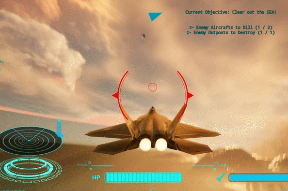

# 李明浩 · Minghao

**游戏玩法程序 / 引擎与图形程序**

`C++` · `Unreal Engine 5` · `实时图形` · `游戏 AI`

`利物浦大学 · 计算机科学学士` · `华威大学 · 游戏工程硕士`

## 关于我

我专注于把玩法机制做成清晰、响应及时且可持续迭代的系统，主要实践方向是第三人称战斗、游戏 AI、实时渲染与性能优化。

独立完成过完整的 UE5 类魂战斗原型与 C++ 光线/路径追踪渲染器，熟悉从 C++ 系统层、Blueprint 玩法组合到 UI、音效与调试反馈的完整实现链路。

**求职方向：游戏玩法程序 / 引擎与图形程序**

## 重点项目

### [Kung Fu Souls](https://github.com/SNNNNNNNNNNNNNNNNNNNNNNNNNNNNNNNNNNNNNN/KungFuSouls3) · 第三人称类魂战斗 Demo

**独立项目** · `2025.10 - 2026.06`

`Unreal Engine 5.7` `C++` `Blueprint` `Enhanced Input` `Behavior Tree`

- **战斗手感**：基于 Enhanced Input 实现移动、视角、攻击、闪避、治疗与锁定；用动画蒙太奇连接斩击连招、重击、受击和四向闪避。
- **敌人与 Boss**：用行为树和黑板搭建追击、挥砍与重击逻辑，接入伤害接口、生命值、耐力状态和命中判定。
- **反馈与界面**：实现 GameInstance 与主菜单 UMG，集成 HUD、敌人/Boss 血条、锁定目标 UI、镜头震动和受击音效。

[项目说明与源码](https://github.com/SNNNNNNNNNNNNNNNNNNNNNNNNNNNNNNNNNNNNNN/KungFuSouls3)

### Skyfire Uprising · Level 4

**空中战斗关卡 · 团队项目** · `2026`

`Unreal Engine 5` `Blueprint` `Animation Blueprint` `Niagara`

- **防空系统**：搭建目标检测、持续瞄准、射程检测和骨骼网格旋转逻辑，将敌人状态与武器行为连接起来。
- **火炮与特效**：以事件驱动方式处理发射、弹道和伤害判定，接入动画蒙太奇、生命值逻辑与 Niagara 光束特效。
- **问题修复**：定位并解决光束起止位置、旋转速度、蒙太奇衔接和组件变换问题，提升系统稳定性。

[项目仓库](https://github.com/pobertt/Skyfire_Uprising_Level4)

## 其他项目

### C++ 光线追踪 / 路径追踪渲染器

`C++` `Multithreading` `Computer Graphics` `2024`

实现并扩展光线追踪、路径追踪、光源追踪、即时辐射度、BRDF 采样与渐进式累积；加入色调映射、降噪和法线/反照率缓冲区，并通过多线程与模块化渲染组件持续做性能调试。

### 数独生成与求解器

`Java` `Algorithms` `UI Logic` `2024`

实现棋盘生成、可解性检查、逻辑求解、回溯算法与难度评分；提示系统会给出下一步有效操作及判断依据，代码按生成、求解和数据层组织。

## 技术栈

| 方向 | 技术 |
| --- | --- |
| 语言 | C++ · Python · Java · SQL |
| 引擎 | Unreal Engine 5 · Blueprint · UMG · Enhanced Input · Gameplay Framework |
| 图形 | DirectX 11/12 · DXR · 光线追踪 · 路径追踪 · 光栅化 · 色调映射 |
| 系统 | 多线程 · 性能优化 · 调试 · 数据库 · UI 与音频集成 |
| 工具 | Git · GitHub · Visual Studio · Blender |

## 联系方式

- 邮箱：[1441998284l@gmail.com](mailto:1441998284l@gmail.com)
- GitHub：[@SNNNNNNNNNNNNNNNNNNNNNNNNNNNNNNNNNNNNNN](https://github.com/SNNNNNNNNNNNNNNNNNNNNNNNNNNNNNNNNNNNNNN)
